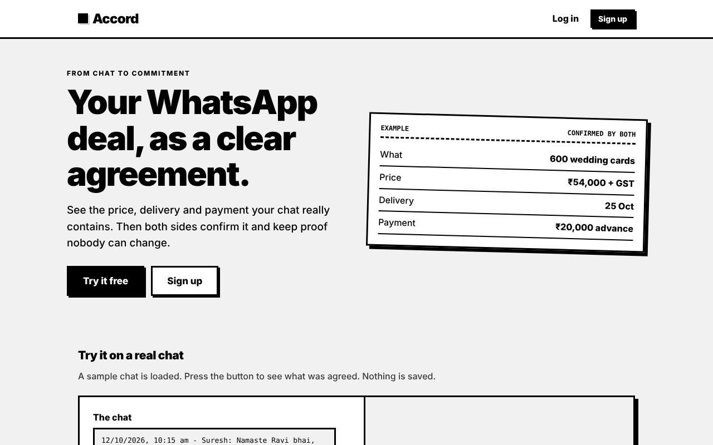
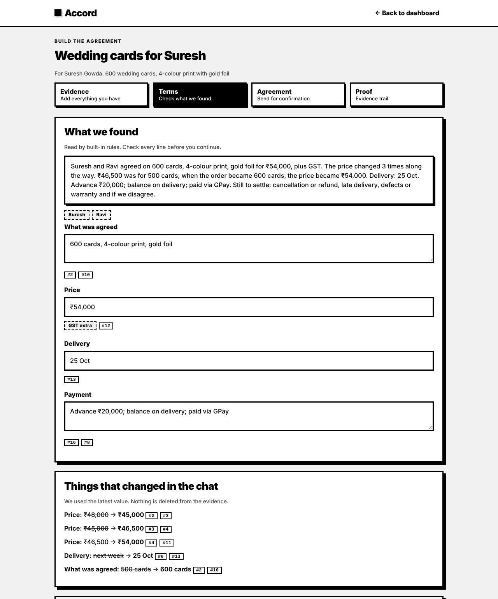
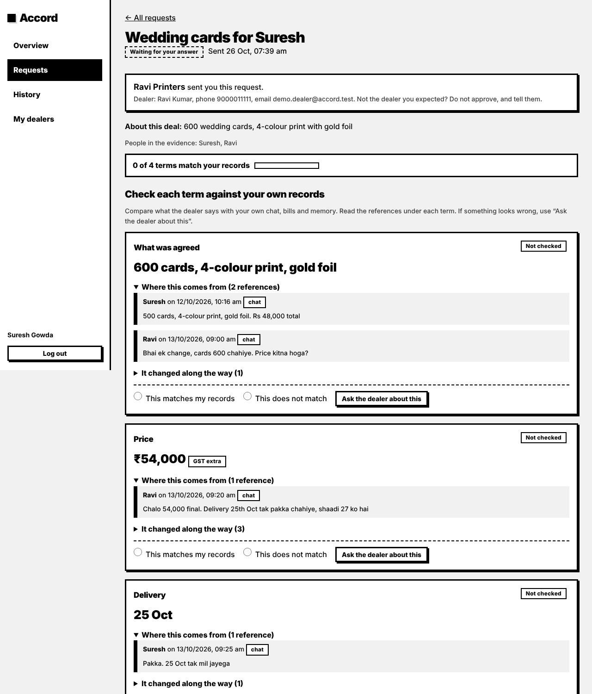
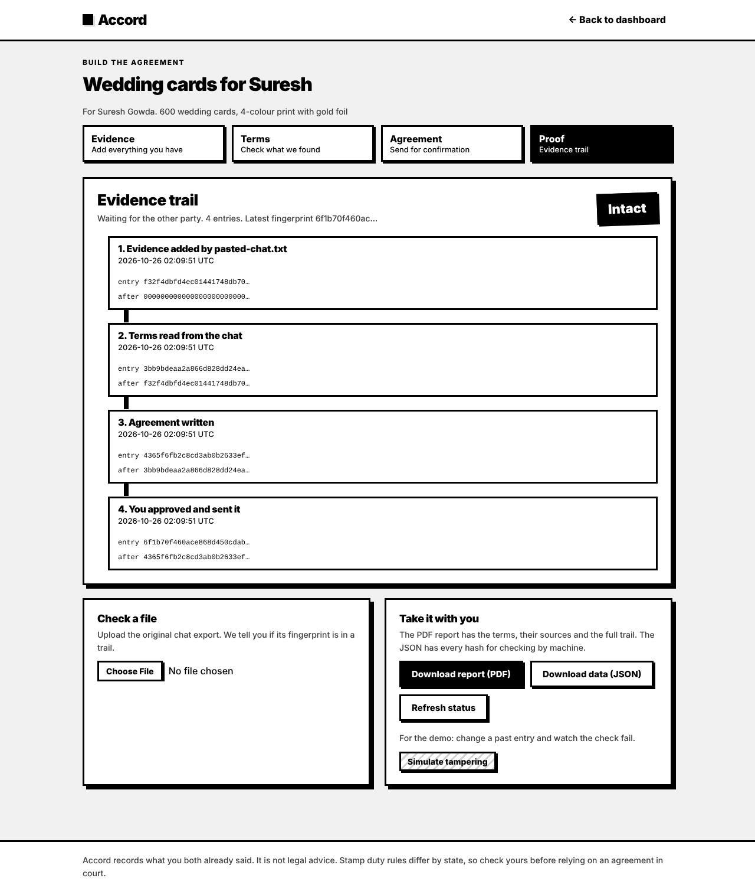

<div align="center">

# ◼ Accord

### From chat to commitment.

**Accord turns an informal WhatsApp deal into a clear, plain-language agreement that both sides confirm, backed by a tamper-evident evidence trail.**

[](https://accord-zwqk.onrender.com/)

[](docs/Accord_Project_Report.pdf)
[](docs/Accord_Presentation.pptx)
[](#-testing)
[](#-quick-start)
[](#-architecture)
[](LICENSE)

**Team Big Leagues** · Hackathon problem **LS-06: From Handshake to Contract (Informal Agreements)**

</div>

---

## 🔗 Quick links

| | Link |
|---|---|
| 🌐 **Live website** | **<https://accord-zwqk.onrender.com/>** |
| 📄 **Project report (PDF)** | [docs/Accord_Project_Report.pdf](docs/Accord_Project_Report.pdf) |
| 📊 **Presentation (PPTX)** | [docs/Accord_Presentation.pptx](docs/Accord_Presentation.pptx) · [download](https://github.com/chinmay6537/Accord/raw/main/docs/Accord_Presentation.pptx) |
| 💻 **Source code** | You are here: [github.com/chinmay6537/Accord](https://github.com/chinmay6537/Accord) |

## 🔑 Demo logins

The live site and every fresh local copy come with a ready-made dealer, customer and one deal already sent between them.

| Role | Email | Password |
|---|---|---|
| 🏪 **Dealer** (Ravi Printers) | `demo.dealer@accord.test` | `demo12345` |
| 🙋 **Customer** (Suresh Gowda) | `demo.customer@accord.test` | `demo12345` |

> [!TIP]
> Log in as the **dealer** in a normal browser window and as the **customer** in a **private / incognito** window. Login is stored per browser, so one window can only be one person.

> [!NOTE]
> The live demo runs on a free plan. It **sleeps after ~15 minutes** without visitors, so the first visit can take **30–60 seconds** to wake up. Accounts you create are cleared when it restarts; the demo accounts above always come back.

**Suggested two-minute run**
1. **Customer:** open the request, mark all four terms as matching, ask a question in chat, then approve.
2. **Dealer:** open the ticket and see it marked **Confirmed**, with what the customer checked recorded in the evidence trail. Download the PDF report.

No account? Press **Try it free** on the [home page](https://accord-zwqk.onrender.com/) to run the reader on a sample Hinglish chat.

---

## 📸 Screenshots

<table>
  <tr>
    <td width="50%"><br><sub><b>Landing page</b>: try the reader on a real chat without an account</sub></td>
    <td width="50%"><br><sub><b>Dealer · Terms</b>: every value linked to its source messages, plus what changed along the way</sub></td>
  </tr>
  <tr>
    <td width="50%"><br><sub><b>Customer review</b>: check each term against the cited messages before approving</sub></td>
    <td width="50%"><br><sub><b>Proof</b>: hash-chained evidence trail, PDF report and the tamper demo</sub></td>
  </tr>
</table>

---

## 📚 Table of contents

1. [The problem](#-the-problem)
2. [What Accord does](#-what-accord-does)
3. [Features](#-features)
4. [How it works](#-how-it-works)
5. [Quick start](#-quick-start)
6. [Run with a local AI model](#-run-with-a-local-ai-model-optional)
7. [Configuration](#-configuration)
8. [Using the app](#-using-the-app)
9. [Architecture](#-architecture)
10. [API overview](#-api-overview)
11. [Security and trust model](#-security-and-trust-model)
12. [Testing](#-testing)
13. [Project structure](#-project-structure)
14. [Design system](#-design-system)
15. [Deploying](#-deploying)
16. [Roadmap](#-roadmap)
17. [Known limitations](#-known-limitations)
18. [Team](#-team)

---

## 💬 The problem

Small businesses in India close real deals over WhatsApp: a price here, a delivery date there, an advance sent by UPI. When something goes wrong, nobody can say with confidence what was agreed. The price changed four times. The delivery date was "next week", then "25th". The advance was mentioned in a voice note. Formal contracts feel heavy and legalistic for these relationships, so they are never written.

## ✨ What Accord does

1. **Reads** the conversation (chat export, voice notes, screenshots, documents, call notes).
2. **Extracts** the key terms: parties, scope, price, delivery, payment, each linked to the exact messages it came from.
3. **Flags** what is missing or unclear, and drafts a friendly message to settle each point.
4. **Generates** a plain-language agreement.
5. **Lets the other person check** every term against the evidence, discuss it, and approve.
6. **Records** every step in a hash chain so any later change is detectable.

The tone stays human. Nothing is presented as a legal contract unless the users choose that.

## 🧩 Features

**📥 Evidence collection**
- WhatsApp `.txt` exports, `.zip` exports with media, and pasted chats
- Voice notes (Whisper transcription when configured, otherwise typed by the user)
- Screenshots (read with Claude vision when configured, otherwise typed)
- PDF, Word and text files, plus typed notes for calls and in-person agreements
- Multiple sources merged into one timeline by date, so a later voice note can override a price in the chat
- Every item fingerprinted with SHA-256 at the moment it is added; removing an item keeps the original and logs the removal

**🔍 Term extraction**
- Parties, scope, price (with GST status), delivery date and payment terms
- Citations to the source messages for every value
- Change tracking: when a price or date is revised, the latest value is used and the history is shown
- Gap detection with ready-to-send nudges (cancellation, late delivery, defects, disputes)
- Built-in rules engine that works offline; optional local model (Qwen via Ollama) or Claude, always checked against the chat

**👥 Two roles, two experiences**
- **Dealer:** dashboard with overview, tickets, customers and segments; builds the evidence and agreement for each ticket
- **Customer:** view-only portal where each term is verified against its references, questions go to the dealer in chat, and approval is unlocked only after every term is checked
- Chat and comments on each agreement; comments are written into the evidence trail

**🔒 Proof**
- Hash-chained evidence trail, re-verified on every view
- Stored files are re-hashed so a swapped file is caught
- **PDF export:** the agreement, and a full evidence report (terms, sources, changes, files with fingerprints, step-by-step trail). A customer's copy contains only the messages cited behind terms
- Evidence bundle download (JSON) and a file checker for the original chat export

**🌐 Public demo**
- The landing page runs a free demo on any pasted chat (rules engine only, rate limited, nothing saved). Everything beyond it requires an account.

## 🔄 How it works

```
Evidence --> Terms --> Agreement --> Confirmation --> Proof
 (dealer)   (dealer)    (dealer)     (customer)      (both)
```

1. The dealer creates a **ticket** for a customer and adds evidence.
2. The reader extracts terms; the dealer reviews and corrects them.
3. The dealer generates the agreement and sends it.
4. The customer opens the request, checks each term against the cited messages, asks questions if needed, then approves or asks for changes.
5. Every step is appended to a hash chain. Approval stores which terms the customer checked.

A **ticket** is one deal with one customer. Statuses: collecting, draft, sent, confirmed, change requested.

---

## 🚀 Quick start

Requirements: **Python 3.10 or newer**. No API keys are needed.

```bash
git clone https://github.com/chinmay6537/Accord.git
cd Accord

python -m venv .venv
source .venv/bin/activate          # Windows: .venv\Scripts\activate
pip install -r requirements.txt

python scripts/seed_demo.py        # creates the demo dealer, customer and one sent ticket
uvicorn app.main:app --reload
```

Open <http://localhost:8000> and log in with the [demo accounts](#-demo-logins).

Without any keys the app uses the built-in rules engine, which handles the bundled sample chat.

## 🧠 Run with a local AI model (optional)

Accord can read chats with a model running entirely on your own Mac through Ollama: no API key, and nothing leaves the laptop. On an Apple Silicon Mac with 16 GB of RAM:

```bash
bash setup_mac.sh     # once: installs Ollama, downloads qwen2.5:7b (4.7 GB), builds the accord-reader model, tests it
bash run_mac.sh       # every time: starts Ollama and Accord with the local model
```

Full guide: [LOCAL_LLM.md](LOCAL_LLM.md). If the model is unreachable, the built-in rules answer instead and the page says so.

## 🔧 Configuration

Copy `.env.example` to `.env`. All settings are optional.

| Variable | Default | Purpose |
|---|---|---|
| `LLM_PROVIDER` | `auto` | Which reader extracts terms: `auto`, `claude`, `local` or `rules`. Model answers are always checked against the chat. |
| `SEED_DEMO` | `0` | Set to `1` to create the demo dealer, customer and ticket on every start (used by `start.sh`). |
| `PORT` | `8000` | Port used by `start.sh` (hosts set this for you). |
| `ANTHROPIC_API_KEY` | empty | Enables Claude extraction and screenshot reading. Without it the rules engine is used. |
| `CLAUDE_MODEL` | `claude-sonnet-5-5` | Model used for extraction. |
| `LOCAL_LLM_URL`, `LOCAL_LLM_TOKEN` | empty | A model on another machine (see [LOCAL_LLM.md](LOCAL_LLM.md)). With `LLM_PROVIDER=local` and no URL, Ollama on the same machine is used. |
| `OPENAI_API_KEY` | empty | Enables Whisper transcription of voice notes. |
| `DEMO_MODE` | `1` | Shows the confirmation code on screen. Set to `0` and connect an SMS provider for real use. |
| `DB_PATH` | `data/accord.db` | SQLite database file. |
| `UPLOAD_DIR` | `data/uploads` | Where uploaded evidence files are stored. |
| `MAX_UPLOAD_MB` | `25` | Upload size limit. |

## 🧭 Using the app

### 🏪 Dealer

1. **Sign up** as a dealer, or log in.
2. **Customers:** add a customer and copy their private invite link.
3. **New ticket:** give it a title, pick the customer and add a description.
4. On the ticket page:
   - **Evidence:** add chats, voice notes, screenshots, documents or call notes, then press *Read the evidence*.
   - **Terms:** review what was found and the messages behind each value. Resolve the open points using the suggested messages.
   - **Agreement:** choose a friendly or formal tone and press *Send for confirmation*.
   - **Proof:** inspect the evidence trail and its integrity status.
5. Chat with the customer from the ticket. Track everything under **Tickets**.

### 🙋 Customer

1. Open the dealer's invite link and sign up as a customer.
2. Open a request from **Requests**.
3. For each term, read the cited messages and mark it as matching or not matching.
4. Use *Ask the dealer about this* to start a chat with the question filled in.
5. Approve once every term matches, or choose *Ask for changes*.

Customers cannot create tickets, customers or evidence.

### 🔗 Linking customers to accounts

Customers are connected to a dealer's records through the private invite link (`/join/<token>`). Accord deliberately does **not** match accounts by email or phone, because neither is verified and matching would let anyone see an agreement by typing someone else's number.

### ✅ No-account confirmation

Each sent agreement also has a one-time link (`/c/<token>`) where a person without an account can confirm using a phone code. In demo mode the code is shown on screen.

---

## 🧱 Architecture

| Layer | Choice |
|---|---|
| **Backend** | FastAPI with SQLite (`sqlite3`). No ORM. |
| **Frontend** | Plain HTML, CSS and JavaScript. No build step. Each page is one `.html` shell, the shared stylesheet and one page script. |
| **Extraction** | Built-in rules engine by default; optional local model (Ollama) or Claude, selected by `LLM_PROVIDER`. |
| **Proof** | Each event stores the SHA-256 of its content and the hash of the previous entry. Editing any past entry breaks every later link. |
| **Sessions** | Server-side sessions with an HttpOnly cookie; only a hash of the token is stored. |

## 🔌 API overview

Interactive docs are available at [`/docs`](https://accord-zwqk.onrender.com/docs) while the server is running.

| Area | Endpoints |
|---|---|
| Auth | `POST /api/auth/signup`, `POST /api/auth/login`, `POST /api/auth/logout`, `GET /api/auth/me` |
| Invites | `GET /api/join/{token}`, `POST /api/join/{token}` |
| Public demo | `POST /api/demo`, `GET /api/sample` |
| Dealer | `/api/dealer/overview`, `/api/tickets`, `/api/customers`, `/api/segments` |
| Evidence | `GET/POST /api/cases/{id}/items`, `POST /api/cases/{id}/analyze` |
| Agreement | `PUT /api/deals/{id}/terms`, `POST /api/deals/{id}/agreement`, `POST /api/deals/{id}/send` |
| Proof | `GET /api/deals/{id}`, `GET /api/deals/{id}/bundle`, `POST /api/verify-file` |
| PDF | `GET /api/deals/{id}/agreement.pdf`, `GET /api/deals/{id}/report.pdf`, `GET /api/my/tickets/{id}/agreement.pdf`, `GET /api/my/tickets/{id}/report.pdf`, `GET /api/c/{token}/agreement.pdf` |
| Customer | `GET /api/my/tickets`, `GET /api/my/tickets/{id}`, `PUT /api/my/tickets/{id}/checks/{field}`, `POST /api/my/tickets/{id}/respond`, `GET /api/my/dealers` |
| Chat | `GET/POST /api/tickets/{id}/thread` |
| No-account link | `GET /api/c/{token}`, `POST /api/c/{token}/otp`, `POST /api/c/{token}/respond` |

## 🔐 Security and trust model

- Passwords are hashed with scrypt. Login attempts are throttled per account.
- Dealers can only access their own tickets and customers; every dealer route checks ownership.
- Customers only see requests sent to their account, and only the messages cited behind each term, never the dealer's private notes or the full chat.
- Approval is enforced on the server: the customer must have checked every agreed term as matching.
- The public demo never calls a paid API, limits input to 8,000 characters and 8 requests per minute per visitor, and stores nothing.
- The hash chain makes tampering **evident**, not impossible. For stronger guarantees, share the latest fingerprint with both parties at each step or anchor it with an external timestamping service.

## 🧪 Testing

```bash
python -m pytest -q tests
```

**39 tests, all passing.** The suite covers the full workflow, the evidence page, accounts and roles, dealer isolation, invite linking, customer verification gating, extraction (including the local-model path and its fallback), the public demo and PDF export (including who may download what).

## 📁 Project structure

```
app/                     Python backend
  main.py                  page routes and the evidence/agreement workflow API
  routes_auth.py           sign up, log in, log out, invite lookup
  routes_demo.py           public landing-page demo
  routes_export.py         PDF downloads (agreement, evidence report)
  pdf.py  fonts/           PDF builder and the bundled fonts
  routes_dealer.py         overview, tickets, customers, segments
  routes_customer.py       customer review: terms, references, checks, approval
  routes_thread.py         chat and comments on a ticket
  proof.py                 hash chain and stored-file verification
  auth.py  common.py       sessions, passwords, shared helpers
  ingest.py  parser.py  extract.py  agreement.py  evidence.py  db.py
static/                  Frontend
  css/style.css            the single design system
  js/common.js             shared helpers (loaded first)
  js/thread.js             chat component
  landing.html  js/landing.js     public page with the free demo
  login.html    js/auth.js        log in, sign up, customer invite
  dealer.html   js/dealer.js      dealer dashboard
  customer.html js/customer.js    customer portal
  ticket.html   js/ticket.js      evidence, terms, agreement, proof
  confirm.html  js/confirm.js     no-account confirmation
docs/                    Project report (PDF), presentation (PPTX) and screenshots
scripts/                 seed_demo.py (demo data), check_local_llm.py, llm_gateway.py
Modelfile  setup_mac.sh  run_mac.sh  LOCAL_LLM.md   local AI model setup
Dockerfile  start.sh  render.yaml  DEPLOY.md        deployment files and guide
samples/                 sample Hinglish chat
tests/                   pytest suite
```

## 🎨 Design system

Black and white neo-brutalism, defined once in `static/css/style.css`. There are no colours; meaning is carried by shape and text.

| Look | Meaning |
|---|---|
| ■ Solid black | Done, confirmed |
| ┅ Dashed grey | Waiting, notice |
| ▨ Diagonal stripes | Problem, needs attention |

Thick 3px borders, hard offset shadows, square corners, Archivo and JetBrains Mono. New screens should reuse the existing classes and avoid per-page styles.

## 🌍 Deploying

The live demo runs on Render's free plan straight from this repo (`render.yaml`). See [DEPLOY.md](DEPLOY.md) for step-by-step guides (Render, Railway, Fly.io, Docker) and a post-deploy checklist. The repo ships with a `Dockerfile`, `start.sh` and `render.yaml`.

## 📍 Roadmap

- Dealer revises the agreement after a change request and re-sends it
- Email and phone verification, password reset
- Notifications when the other party replies (chat currently polls every 4 seconds)
- Real SMS or WhatsApp confirmation codes
- State-wise stamp duty estimator and a Section 63 BSA certificate draft
- Hindi and Kannada agreement output
- Offline speech-to-text for voice notes

## 🚧 Known limitations

- The offline rules engine is tuned to the sample chat. Real, messy chats give better results with a model (local or Claude).
- Voice transcription and screenshot reading depend on external API keys and have not been tested against the live services in the project's own test suite.
- SQLite and in-memory throttling suit a single server process, not a multi-instance deployment.
- Confirmation codes are shown on screen in demo mode.

---

## 👥 Team

**Team Big Leagues**

| Member | Role |
|---|---|
| **Chinmay S** | Backend: server, database, accounts, evidence chain, extraction logic, PDF export, testing and deployment |
| **Bhakti Chethan** | UI and UX design |
| **Ayush Iyer** | AI integration |
| **Ayush Prashanth** | User interface and the landing page |

## 📜 Disclaimer

Accord is not legal advice and does not provide verified electronic signatures. It helps people keep a clear, checkable record of an informal agreement. Enforceability and stamp duty depend on the state and the situation.

<div align="center">
<br>
<b>Informal doesn't have to mean unprovable.</b>
<br><br>
<sub>Released under the <a href="LICENSE">MIT License</a>.</sub>
</div>
